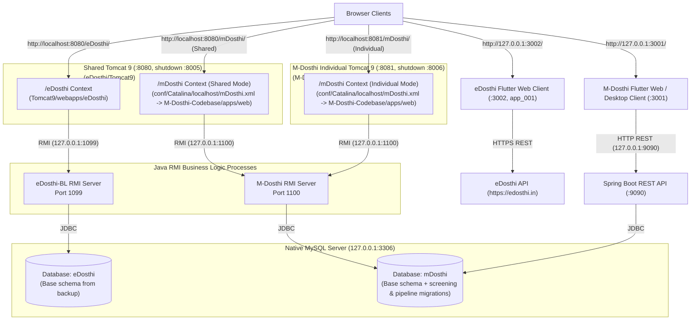

# All-in-One README, Setup & Run Guide, and Shared + Individual Tomcat Implementation (eDosthi & M-Dosthi + API + Flutter Web)

This guide is the complete, end-to-end reference for setting up, configuring, and running **eDosthi**, **M-Dosthi Legacy Web**, **M-Dosthi Spring Boot API**, and **M-Dosthi Flutter Web / Desktop** natively (without Docker) on **macOS, Linux, and Windows**, supporting **both** a **Shared Tomcat 9 (`:8080`)** and **M-Dosthi's Individual Tomcat 9 (`:8081`)** alongside separate **Java RMI** business-logic servers and a local **MySQL** database server.

> [!IMPORTANT]
> - **Never commit real passwords, tokens, or patient data** to documentation or Git. Replace placeholders such as `YOUR_DB_USER` and `YOUR_DB_PASSWORD` with your local environment values, and use `-p` / `--password` (prompted interactively) instead of passing passwords on the command line.
> - **Do not wrap values in `<` or `>` angle brackets** in terminal commands (e.g., write `-u root`, never `-u <root>`), because `zsh` and `bash` treat `<` and `>` as file input/output redirections.

---

## 1. System Architecture & Port Map



### Service & Port Summary

| Service | URL / Host:Port | Directory / Config File | Notes |
| :--- | :--- | :--- | :--- |
| **eDosthi Web UI** | `http://localhost:8080/eDosthi/` | [Tomcat9/webapps/eDosthi](CodeBase/eDosthi%20codebases/DEVELOPMENT/eDosthi/Tomcat9/webapps/eDosthi) | Context `/eDosthi` |
| **M-Dosthi Web UI (Shared Tomcat)** | `http://localhost:8080/mDosthi/` | [M-Dosthi-Codebase/apps/web](CodeBase/M-Dosthi-Codebase/apps/web) | Mounted on Shared Tomcat `:8080` via `mDosthi.xml` |
| **M-Dosthi Web UI (Individual Tomcat)** | `http://localhost:8081/mDosthi/` | [M-Dosthi-Codebase/apps/web](CodeBase/M-Dosthi-Codebase/apps/web) | Mounted on M-Dosthi Tomcat `:8081` via `mDosthi.xml` |
| **Shared Tomcat 9** | `localhost:8080` (shutdown `8005`) | [eDosthi/Tomcat9](CodeBase/eDosthi%20codebases/DEVELOPMENT/eDosthi/Tomcat9) | Pointed to by `SHARED_TOMCAT_HOME` or `--shared` |
| **M-Dosthi Individual Tomcat 9** | `localhost:8081` (shutdown `8006`) | [M-Dosthi-Codebase/Tomcat9](CodeBase/M-Dosthi-Codebase/Tomcat9) ([tools/tomcat9](CodeBase/M-Dosthi-Codebase/tools/tomcat9)) | Bundled in M-Dosthi (`--individual` or default) |
| **eDosthi RMI (`eDosthi-BL`)** | `127.0.0.1:1099` | [eDosthi-BL/gblinfo.inf](CodeBase/eDosthi%20codebases/DEVELOPMENT/eDosthi/eDosthi-BL/gblinfo.inf) | `blport = 1099`, DB: `eDosthi` |
| **M-Dosthi RMI** | `127.0.0.1:1100` | [runtime/gblinfo.inf](CodeBase/M-Dosthi-Codebase/services/legacy/runtime/gblinfo.inf) | `blport = 1100`, DB: `mDosthi` |
| **Spring Boot API** | `http://localhost:9090` | [services/api](CodeBase/M-Dosthi-Codebase/services/api) | Started via `scripts/api.sh` / `scripts/api.ps1` |
| **M-Dosthi Flutter Web Client** | `http://127.0.0.1:3001/` | [apps/mobile](CodeBase/M-Dosthi-Codebase/apps/mobile) | `mdosthi_app`; calls local Spring Boot API on `http://127.0.0.1:9090` |
| **eDosthi Flutter Web Client** | `http://127.0.0.1:3002/` | [Downloads/tathyanu codebase and database /btp](CodeBase/eDosthi%20codebases/Downloads/tathyanu%20codebase%20and%20database%20/btp) | `app_001`; targets `https://edosthi.in` (run from scratch copy to keep `eDosthi` untouched) |
| **MySQL 8 / 9** | `127.0.0.1:3306` | Native OS Service (`brew` / `systemd` / Windows Service) | Databases: `eDosthi`, `mDosthi` |

---

## 2. Prerequisites & Native Dependency Installation (No Docker)

### macOS (Homebrew)
```bash
brew install git openjdk@25 mysql maven
brew install --cask flutter
brew services start mysql
export JAVA_HOME="/opt/homebrew/opt/openjdk@25/libexec/openjdk.jdk/Contents/Home"
export PATH="$JAVA_HOME/bin:/opt/homebrew/bin:$PATH"
```

### Linux (Ubuntu / Debian)
```bash
sudo apt update
sudo apt install -y git curl tar unzip openjdk-25-jdk maven mysql-server mysql-client \
  clang cmake ninja-build pkg-config libgtk-3-dev liblzma-dev
sudo snap install flutter --classic
sudo systemctl enable --now mysql
export JAVA_HOME="/usr/lib/jvm/java-25-openjdk-amd64"
export PATH="$JAVA_HOME/bin:$PATH"
```

### Windows (PowerShell + Winget)
```powershell
winget install Git.Git EclipseAdoptium.Temurin.25.JDK Apache.Maven Oracle.MySQL Google.Flutter
Start-Service MySQL80
```

---

## 3. Database Creation & Backup Restoration

### Step 3.1: Create the `eDosthi` and `mDosthi` Schemas
```bash
mysql --host=127.0.0.1 --user=YOUR_DB_USER -p <<'SQL'
CREATE DATABASE IF NOT EXISTS eDosthi CHARACTER SET utf8mb4 COLLATE utf8mb4_unicode_ci;
CREATE DATABASE IF NOT EXISTS mDosthi CHARACTER SET utf8mb4 COLLATE utf8mb4_unicode_ci;
SQL
```

### Step 3.2: Normalize Backup Definer and Import into `eDosthi` and `mDosthi`
If the SQL backup dump ([sqldumps/eDosthi_merged.sql](CodeBase/eDosthi%20codebases/DEVELOPMENT/sqldumps/eDosthi_merged.sql)) contains `DEFINER=\`root\`@\`%\`` on triggers/routines, normalize it to `DEFINER=\`root\`@\`localhost\`` before importing:

```bash
# 1. Normalize DEFINER clauses in the backup dump
LC_ALL=C sed 's/DEFINER=`root`@`%`/DEFINER=`root`@`localhost`/g' \
  "/path/to/sqldumps/eDosthi_merged.sql" \
  > /tmp/eDosthi_backup_clean.sql

# 2. Import backup into eDosthi database
mysql --host=127.0.0.1 --user=YOUR_DB_USER --database=eDosthi -p < /tmp/eDosthi_backup_clean.sql

# 3. Import backup into mDosthi database
mysql --host=127.0.0.1 --user=YOUR_DB_USER --database=mDosthi -p < /tmp/eDosthi_backup_clean.sql

# 4. Apply M-Dosthi screening & monitoring migrations to mDosthi
for f in CodeBase/M-Dosthi-Codebase/database/migrations/*.sql; do
  mysql --host=127.0.0.1 --user=YOUR_DB_USER --database=mDosthi -p < "$f"
done

# 5. Apply Spring Boot API pipeline queue & complete longitudinal schema
mysql --host=127.0.0.1 --user=YOUR_DB_USER --database=mDosthi -p \
  < CodeBase/M-Dosthi-Codebase/services/api/src/main/resources/db/manual/V20261029_01__pipeline_job_queue.sql
mysql --host=127.0.0.1 --user=YOUR_DB_USER --database=mDosthi -p \
  < CodeBase/M-Dosthi-Codebase/services/api/src/main/resources/db/manual/V20261113_01__complete_api_schema.sql
```

> [!TIP]
> For general commands to inspect databases, schemas, tables, columns, indexes, and row counts, see [DATABASE_INSPECTION_GUIDE.md](CodeBase/DATABASE_INSPECTION_GUIDE.md).

---

## 4. How Shared Tomcat, Individual Tomcat, API & Flutter Web Were Implemented

### 4.1 Side-by-Side Comparison: eDosthi vs M-Dosthi (Shared Tomcat & Individual Tomcat)

| Aspect | Original eDosthi Implementation | M-Dosthi Shared Tomcat (`:8080`) | M-Dosthi Individual Tomcat (`:8081`) |
| :--- | :--- | :--- | :--- |
| **Tomcat Directory** | [eDosthi/Tomcat9](CodeBase/eDosthi%20codebases/DEVELOPMENT/eDosthi/Tomcat9) | Reuses [eDosthi/Tomcat9](CodeBase/eDosthi%20codebases/DEVELOPMENT/eDosthi/Tomcat9) via `SHARED_TOMCAT_HOME` or `--shared` | Dedicated [M-Dosthi-Codebase/Tomcat9](CodeBase/M-Dosthi-Codebase/Tomcat9) ([tools/tomcat9](CodeBase/M-Dosthi-Codebase/tools/tomcat9)) via `--individual` (default) |
| **HTTP & Shutdown Ports** | HTTP `8080`, Shutdown `8005` | HTTP `8080`, Shutdown `8005` (`http://localhost:8080/mDosthi/`) | HTTP `8081`, Shutdown `8006` (`http://localhost:8081/mDosthi/`, configurable via `TOMCAT_HTTP_PORT`) |
| **Web Deployment** | Physically inside `Tomcat9/webapps/eDosthi/` | Mounted from `M-Dosthi-Codebase/apps/web/` via `eDosthi/Tomcat9/conf/Catalina/localhost/mDosthi.xml` | Mounted from `M-Dosthi-Codebase/apps/web/` via `M-Dosthi-Codebase/tools/tomcat9/conf/Catalina/localhost/mDosthi.xml` |
| **Context & Cookie Path** | `/eDosthi` (`gbltelemedix = /eDosthi`) | `/mDosthi` (`gbltelemedix = /mDosthi`), isolating `JSESSIONID` and auth cookies per app | `/mDosthi` (`gbltelemedix = /mDosthi`), allowing both `:8080/mDosthi/` and `:8081/mDosthi/` to work simultaneously |
| **Finding `config.info`** | `new FileInputStream(p + "config.info")` — requires `config.info` in working directory | Enhanced [projinfo.java](CodeBase/M-Dosthi-Codebase/services/legacy/servlet-src/WEB-INF/classes/src/projinfo.java#L39-L112) to resolve `apps/web/config.info` from `projinfo.class` code-source location | Uses the exact same [projinfo.java](CodeBase/M-Dosthi-Codebase/services/legacy/servlet-src/WEB-INF/classes/src/projinfo.java#L39-L112) lookup to resolve `apps/web/config.info` |
| **RMI Registry Port (`blport`)** | `1099` (`eDosthi-BL/gblinfo.inf`) | `1100` (`services/legacy/runtime/gblinfo.inf` & `apps/web/config.info`) | Shares M-Dosthi's `1100` RMI server without port conflicts |
| **Tomcat & RMI Lifecycle** | `eDosthi-BL/RunServer.sh` + `Tomcat9/bin/startup.sh` | `scripts/legacy.sh start --shared` starts only M-Dosthi RMI (`1100`); leaves Shared Tomcat lifecycle external | `scripts/legacy.sh start --individual` (or `./Tomcat9/bin/startup.sh`) starts both M-Dosthi Individual Tomcat (`:8081`) and M-Dosthi RMI (`1100`) |

---

### 4.2 File-by-File & Line-by-Line Walkthrough

#### 1. Shared Tomcat (`:8080`) & M-Dosthi Individual Tomcat (`:8081`) Setup
- **Shared Tomcat ([eDosthi/Tomcat9](CodeBase/eDosthi%20codebases/DEVELOPMENT/eDosthi/Tomcat9))**:
  - **[eDosthi/Tomcat9/bin/catalina.sh](CodeBase/eDosthi%20codebases/DEVELOPMENT/eDosthi/Tomcat9/bin/catalina.sh#L125-L260)**: Removed hardcoded Linux `JAVA_HOME`/`JRE_HOME` overrides.
  - **[eDosthi/Tomcat9/bin/setenv.sh](CodeBase/eDosthi%20codebases/DEVELOPMENT/eDosthi/Tomcat9/bin/setenv.sh#L1-L18)**: Auto-detects `JAVA_HOME`, sets `CATALINA_PID="$CATALINA_BASE/logs/tomcat.pid"`, and exports `com.sun.org.apache.xml.internal.security.utils` for Java 25 cookie encryption compatibility.
- **M-Dosthi Individual Tomcat ([M-Dosthi-Codebase/Tomcat9](CodeBase/M-Dosthi-Codebase/Tomcat9) → [tools/tomcat9](CodeBase/M-Dosthi-Codebase/tools/tomcat9))**:
  - **[tools/tomcat9/conf/server.xml](CodeBase/M-Dosthi-Codebase/tools/tomcat9/conf/server.xml#L22-L75)**: Configured `<Server port="8006" shutdown="SHUTDOWN">` (line 22) and `<Connector port="8081" protocol="HTTP/1.1" ... />` (line 71) so M-Dosthi's Individual Tomcat can run either standalone or side-by-side with Shared Tomcat (`:8080`/`8005`) without port collisions.
  - **[tools/tomcat9/bin/setenv.sh](CodeBase/M-Dosthi-Codebase/tools/tomcat9/bin/setenv.sh#L1-L39) & [setenv.bat](CodeBase/M-Dosthi-Codebase/tools/tomcat9/bin/setenv.bat#L1-L36)**:
    - Auto-detects `JAVA_HOME` across macOS, Linux, and Windows (JDK 25/21/17).
    - Exports `--add-exports` / `--add-opens` for Java 25 (and sets `CATALINA_PID="$CATALINA_BASE/logs/tomcat.pid"` on Unix).
    - Automatically resolves the `M-Dosthi-Codebase` root (handling both `Tomcat9` symlink and `tools/tomcat9`) and generates `conf/Catalina/localhost/mDosthi.xml` pointing `docBase` to `apps/web` whenever Tomcat starts (even if started directly via `./Tomcat9/bin/startup.sh` or `Tomcat9\bin\startup.bat`).
  - **[tools/tomcat9/lib/mysql-connector-j-8.4.0.jar](CodeBase/M-Dosthi-Codebase/tools/tomcat9/lib/mysql-connector-j-8.4.0.jar) & Webapps Parity**:
    Added `mysql-connector-j-8.4.0.jar` to `tools/tomcat9/lib/` and restored `webapps/WSiMediX` and `webapps/examples/WEB-INF/classes` so M-Dosthi's Individual Tomcat starts with zero errors.
  - **[M-Dosthi-Codebase/.gitignore](CodeBase/M-Dosthi-Codebase/.gitignore#L10-L57)**:
    Un-ignored `!/tools/tomcat9/` and its `bin/*.jar`, `lib/*.jar`, and `webapps/**` artifacts (while keeping `logs/*`, `temp/*`, `work/`, and `conf/Catalina/localhost/*.xml` ignored as local runtime state) so M-Dosthi's bundled Tomcat is tracked in Git.

#### 2. Dual-Mode Context Registration & Template Generation: [scripts/setup.sh](CodeBase/M-Dosthi-Codebase/scripts/setup.sh#L1-L176) & [scripts/setup.ps1](CodeBase/M-Dosthi-Codebase/scripts/setup.ps1#L1-L127)
- **Mode Flags**: Supports `--individual` (`--standalone`) and `--shared` (`--shared=/path/to/tomcat9`) in `setup.sh`, and `-Mode auto|individual|shared` in `setup.ps1`, in addition to `SHARED_TOMCAT_HOME`. Passing `--shared` / `-Mode shared` auto-detects `../eDosthi codebases/DEVELOPMENT/eDosthi/Tomcat9` when `SHARED_TOMCAT_HOME` is unset (and fails explicitly if no shared Tomcat is found).
- **RMI & HTTP Defaults**: Defaults `LEGACY_RMI_PORT=1100` so M-Dosthi's RMI service works with both Individual Tomcat (`:8081`) and Shared Tomcat (`:8080`) without conflicting with `eDosthi-BL` (`1099`), and sets `@TOMCAT_HTTP_PORT@` in `apps/web/config.info.template` (`8081` in Individual mode, `8080` in Shared mode).
- **Context Descriptors**: Creates the root `Tomcat9 -> tools/tomcat9` symlink (Unix) and writes `<Context docBase="..." reloadable="false" />` into:
  1. [M-Dosthi-Codebase/tools/tomcat9/conf/Catalina/localhost/mDosthi.xml](CodeBase/M-Dosthi-Codebase/tools/tomcat9/conf/Catalina/localhost/mDosthi.xml#L1) (Individual Tomcat)
  2. [eDosthi/Tomcat9/conf/Catalina/localhost/mDosthi.xml](CodeBase/eDosthi%20codebases/DEVELOPMENT/eDosthi/Tomcat9/conf/Catalina/localhost/mDosthi.xml#L1) (Shared Tomcat, when `--shared` / `-Mode shared` or `SHARED_TOMCAT_HOME` is used)

#### 3. External Context Config Lookup: [projinfo.java](CodeBase/M-Dosthi-Codebase/services/legacy/servlet-src/WEB-INF/classes/src/projinfo.java#L38-L112)
In `eDosthi`, `new projinfo("")` opened `new FileInputStream("config.info")`. In `M-Dosthi`, because `/mDosthi` is loaded from `M-Dosthi-Codebase/apps/web` via `mDosthi.xml` in both Individual Tomcat and Shared Tomcat, [projinfo.java](CodeBase/M-Dosthi-Codebase/services/legacy/servlet-src/WEB-INF/classes/src/projinfo.java#L39-L49) resolves `config.info` from the deployed class/JAR path (`configFromWebappLocation`):
```java
String configPath = p + "config.info";
if (p.length() == 0) {
	String catalinaBase = System.getProperty("catalina.base", "");
	if (catalinaBase.length() > 0) {
		configPath = catalinaBase + "/webapps/mDosthi/config.info";
	}
	if (!new File(configPath).isFile()) {
		configPath = configFromWebappLocation(configPath);
	}
}
FileInputStream gblfin = new FileInputStream(configPath);
```

#### 4. Servlet Compilation & RMI Stub Packaging: [makeJar.sh](CodeBase/M-Dosthi-Codebase/services/legacy/servlet-src/WEB-INF/classes/src/makeJar.sh#L19-L35)
- **Line 19**: Resolves `servlet-api.jar` from `$SHARED_TOMCAT_HOME/lib/servlet-api.jar` (Shared mode) or `$PROJECT_ROOT/tools/tomcat9/lib/servlet-api.jar` (Individual mode).
- **Lines 26–33**: Packages both `*Interface.class` and `*_Stub.class` from `services/legacy/server-src` into `logger.jar`, `tuberculosis.jar`, `phiv.jar`, and `onlinegc.jar` in `apps/web/WEB-INF/lib/` so RMI lookups (such as `iMediXLogger` during login) succeed.

#### 5. Dual-Mode Process Management: [scripts/legacy.sh](CodeBase/M-Dosthi-Codebase/scripts/legacy.sh#L1-L313) & [scripts/legacy.ps1](CodeBase/M-Dosthi-Codebase/scripts/legacy.ps1#L1-L266)
- **Mode Selection**: Accepts `build`, `start`, `stop`, `run`, or `status` along with `--individual` (`--standalone`) / `--shared` (or `-Mode individual|shared` in `legacy.ps1`).
- **Port Overrides**: Allows overriding M-Dosthi Individual Tomcat's HTTP port (`TOMCAT_HTTP_PORT`, default `8081`) and shutdown port (`TOMCAT_SHUTDOWN_PORT`, default `8006`) in `tools/tomcat9/conf/server.xml`.
- **`start`**:
  - Verifies `blport` matches in `apps/web/config.info` and `services/legacy/runtime/gblinfo.inf` (`1100`).
  - In **Individual mode** (`--individual`), ensures `tools/tomcat9/conf/Catalina/localhost/mDosthi.xml` is configured and starts M-Dosthi's Individual Tomcat (`tools/tomcat9/bin/startup.sh`, tracked via `tools/tomcat9/logs/tomcat.pid`) if not already running.
  - In **Shared mode** (`--shared`), verifies `conf/Catalina/localhost/mDosthi.xml` exists in the Shared Tomcat and leaves the Shared Tomcat lifecycle external.
  - Starts M-Dosthi's RMI server (`1100`, tracked via `services/legacy/runtime/iMediXBusinessLogic.pid`) if not already running.
- **`stop`**:
  - In **Individual mode**, gracefully stops M-Dosthi's Individual Tomcat (`:8081`) and M-Dosthi's RMI server (`:1100`).
  - In **Shared mode**, stops only M-Dosthi's RMI server without shutting down Shared Tomcat (`:8080`).
- **`status`**: Reports live PID and port status for M-Dosthi RMI (`:1100`), M-Dosthi Individual Tomcat (`:8081`), and Shared Tomcat (`:8080`).

#### 6. Flutter Web & Spring Boot API Compatibility
- **[apps/mobile/pubspec.yaml](CodeBase/M-Dosthi-Codebase/apps/mobile/pubspec.yaml#L42)**:
  Updated `google_fonts` constraint from `^6.2.1` to `'>=6.2.1 <10.0.0'` (resolving to `8.2.1`) so Flutter 3.47+ web/desktop builds succeed without `FontWeight` constant map errors.
- **[services/api/src/main/resources/db/manual/V20261029_01__pipeline_job_queue.sql](CodeBase/M-Dosthi-Codebase/services/api/src/main/resources/db/manual/V20261029_01__pipeline_job_queue.sql) & [V20261113_01__complete_api_schema.sql](CodeBase/M-Dosthi-Codebase/services/api/src/main/resources/db/manual/V20261113_01__complete_api_schema.sql)**:
  Provides the `pipeline_jobs`, `pipeline_settings`, `signal_history`, `session_history`, `session_deltas`, `chat_*`, and `login` columns (`dpdp_agreed`, `rctFlag`, `wa_sent`) expected by the Spring Boot API (`:9090`).
- **MySQL 9 / 26 `MD5()` Compatibility**:
  MySQL 26.x removed the deprecated `MD5()` SQL built-in function. Updated `UserRepositoryImpl.encodePassword(String)` (in [UserRepositoryImpl.class](CodeBase/M-Dosthi-Codebase/services/api/target/classes/imedix/saMiX/dao/UserRepositoryImpl.class) and [UserRepositoryImpl.java](CodeBase/eDosthi%20codebases/DEVELOPMENT/Springboot/saMiX/src/main/java/imedix/saMiX/dao/UserRepositoryImpl.java#L47-L54)) and [UserInfo.java](CodeBase/M-Dosthi-Codebase/services/legacy/server-src/UserInfo.java#L346) to compute MD5 in Java (`DigestUtils.md5DigestAsHex`) instead of executing `SELECT MD5(?)` in MySQL.

---

### 4.3 Configuration Templates (Sanitized)

#### 1. eDosthi Business Logic (`eDosthi-BL/gblinfo.inf`)
```ini
gblcentercode = EXTR
gbldbjdbccriver = com.mysql.cj.jdbc.Driver
gbldburl = jdbc:mysql://127.0.0.1:3306/eDosthi?useUnicode=true&characterEncoding=UTF-8
gbldbusername = YOUR_DB_USER
gbldbpasswd = YOUR_DB_PASSWORD
blport = 1099
tempdatadir = /path/to/eDosthi/eDosthi-BL/temp
SystemLoggerPath = /path/to/eDosthi/eDosthi-BL/SystemLog
GeneralSqlLogPath = /path/to/eDosthi/eDosthi-BL/GenSqlLog
```

#### 2. eDosthi Web App (`Tomcat9/webapps/eDosthi/config.info`)
```ini
01) gblcentercode = XXXX
02) blip = 127.0.0.1
03) blport = 1099
04) gblroot = /path/to/eDosthi/Tomcat9
05) gblhome = http://localhost:8080/eDosthi
06) gbltelemedix = /eDosthi
07) gblsip = 127.0.0.1
08) gbltemp = /path/to/eDosthi/Tomcat9/webapps/eDosthi/temp
```

#### 3. M-Dosthi Business Logic (`services/legacy/runtime/gblinfo.inf`)
```ini
gblcentercode = EXTR
gbldbjdbccriver = com.mysql.cj.jdbc.Driver
gbldburl = jdbc:mysql://127.0.0.1:3306/mDosthi?useUnicode=true&characterEncoding=UTF-8
gbldbusername = YOUR_DB_USER
gbldbpasswd = YOUR_DB_PASSWORD
blport = 1100
tempdatadir = /path/to/M-Dosthi-Codebase/services/legacy/runtime/temp
SystemLoggerPath = /path/to/M-Dosthi-Codebase/services/legacy/runtime/SystemLog
GeneralSqlLogPath = /path/to/M-Dosthi-Codebase/services/legacy/runtime/GenSqlLog
```

#### 4. M-Dosthi Web App (`apps/web/config.info`)
```ini
01) gblcentercode = XXXX
02) blip = 127.0.0.1
03) blport = 1100
04) gblroot = /path/to/M-Dosthi-Codebase/apps/web
05) gblhome = http://localhost:8080/mDosthi
06) gbltelemedix = /mDosthi
07) gblsip = 127.0.0.1
08) gbltemp = /path/to/M-Dosthi-Codebase/apps/web/temp
```

#### 5. M-Dosthi Spring Boot API (`.env`)
```ini
SPRING_DATASOURCE_URL=jdbc:mysql://127.0.0.1:3306/mDosthi?allowPublicKeyRetrieval=true&useSSL=false&serverTimezone=UTC
SPRING_DATASOURCE_USERNAME=YOUR_DB_USER
SPRING_DATASOURCE_PASSWORD=YOUR_DB_PASSWORD
SECRETKEY=YOUR_GENERATED_BASE64_JWT_SECRET
```

---

## 5. Complete Run, Stop & Verification Commands

### 5.1 One-Time Setup & Build (macOS / Linux)
```bash
export JAVA_HOME="/opt/homebrew/opt/openjdk@25/libexec/openjdk.jdk/Contents/Home"
export PATH="$JAVA_HOME/bin:/opt/homebrew/bin:$PATH"

cd CodeBase/M-Dosthi-Codebase
# Configures both M-Dosthi Individual Tomcat (:8081) and Shared Tomcat (:8080)
./scripts/setup.sh --shared
./scripts/legacy.sh build
```

### 5.2 Start Services — Shared Tomcat Mode, Individual Tomcat Mode, or Both (macOS / Linux)
```bash
export JAVA_HOME="/opt/homebrew/opt/openjdk@25/libexec/openjdk.jdk/Contents/Home"
export PATH="$JAVA_HOME/bin:/opt/homebrew/bin:$PATH"
export SHARED_TOMCAT_HOME="CodeBase/eDosthi codebases/DEVELOPMENT/eDosthi/Tomcat9"

# 1. Start MySQL (port 3306)
brew services start mysql

# 2. Start eDosthi RMI Server (port 1099)
cd "CodeBase/eDosthi codebases/DEVELOPMENT/eDosthi/eDosthi-BL"
nohup ./RunServer.sh > rmi.log 2>&1 &
echo $! > rmi.pid

# 3A. Run M-Dosthi in Individual Tomcat Mode (port 8081 + RMI port 1100)
cd CodeBase/M-Dosthi-Codebase
./scripts/legacy.sh start --individual
# Or directly: ./Tomcat9/bin/startup.sh

# 3B. Run M-Dosthi in Shared Tomcat Mode (port 8080 + RMI port 1100)
cd CodeBase/M-Dosthi-Codebase
./scripts/legacy.sh start --shared
cd "$SHARED_TOMCAT_HOME/webapps/eDosthi"
"$SHARED_TOMCAT_HOME/bin/startup.sh"

# Check status of RMI, Individual Tomcat (:8081), and Shared Tomcat (:8080)
cd CodeBase/M-Dosthi-Codebase
./scripts/legacy.sh status --shared

# 5. Start M-Dosthi Spring Boot API (port 9090)
cd CodeBase/M-Dosthi-Codebase
nohup ./scripts/api.sh > api.log 2>&1 &
echo $! > api.pid

# 6. Start M-Dosthi Flutter Web Client (port 3001)
cd CodeBase/M-Dosthi-Codebase/apps/mobile
flutter pub get
flutter run -d web-server --web-hostname 127.0.0.1 --web-port 3001 \
  --dart-define=API_BASE_URL=http://127.0.0.1:9090 \
  --dart-define=API_HOST=127.0.0.1:9090
```

> [!TIP]
> To launch Flutter directly in **Google Chrome** or as a **macOS Desktop App**, run:
> ```bash
> cd CodeBase/M-Dosthi-Codebase/apps/mobile
> flutter run -d chrome --web-port 3001 --dart-define=API_BASE_URL=http://127.0.0.1:9090
> # or
> flutter run -d macos --dart-define=API_BASE_URL=http://127.0.0.1:9090
> ```

### 5.3 Start All Services (Windows PowerShell)
```powershell
$env:SHARED_TOMCAT_HOME = "C:\path\to\eDosthi\Tomcat9"
$env:LEGACY_RMI_PORT = "1100"

cd C:\path\to\M-Dosthi-Codebase
powershell -ExecutionPolicy Bypass -File scripts/setup.ps1
powershell -ExecutionPolicy Bypass -File scripts/legacy.ps1 build

# Start M-Dosthi with Individual Tomcat (:8081) or Shared Tomcat (:8080)
powershell -ExecutionPolicy Bypass -File scripts/legacy.ps1 start -Mode individual
# or: powershell -ExecutionPolicy Bypass -File scripts/legacy.ps1 start -Mode shared

Start-Process -FilePath "C:\path\to\eDosthi\eDosthi-BL\RunServer.bat" -WorkingDirectory "C:\path\to\eDosthi\eDosthi-BL"
& "$env:SHARED_TOMCAT_HOME\bin\startup.bat"
Start-Process powershell -ArgumentList "-ExecutionPolicy Bypass -File scripts/api.ps1"
cd apps\mobile
flutter pub get
flutter run -d web-server --web-hostname 127.0.0.1 --web-port 3001 --dart-define=API_BASE_URL=http://127.0.0.1:9090
```

### 5.4 Stop Services
```bash
export SHARED_TOMCAT_HOME="CodeBase/eDosthi codebases/DEVELOPMENT/eDosthi/Tomcat9"

# Stop M-Dosthi Individual Tomcat (:8081) and M-Dosthi RMI (:1100)
CodeBase/M-Dosthi-Codebase/scripts/legacy.sh stop --individual

# Stop Shared Tomcat (:8080, serving /eDosthi and /mDosthi)
"$SHARED_TOMCAT_HOME/bin/shutdown.sh"

# Stop eDosthi RMI (port 1099)
kill "$(cat "CodeBase/eDosthi codebases/DEVELOPMENT/eDosthi/eDosthi-BL/rmi.pid")"

# Stop Spring Boot API (port 9090)
kill "$(cat CodeBase/M-Dosthi-Codebase/api.pid)"
```

### 5.5 Verify All Ports & Web Contexts
```bash
# 1. Verify listening ports (3306 = MySQL, 8080 = Shared Tomcat, 8081 = M-Dosthi Individual Tomcat, 1099 = eDosthi RMI, 1100 = M-Dosthi RMI, 9090 = API, 3001 = Flutter Web)
lsof -iTCP -sTCP:LISTEN -P -n | grep -E "3306|8080|8081|1099|1100|9090|3001"

# 2. Verify HTTP 200 on Shared Tomcat (:8080), M-Dosthi Individual Tomcat (:8081), and Flutter Web (:3001)
curl -I http://localhost:8080/eDosthi/
curl -I http://localhost:8080/mDosthi/
curl -I http://localhost:8081/mDosthi/
curl -I http://127.0.0.1:3001/
```

---

## 6. M-Dosthi Individual Tomcat Quick Guide (Standalone / No eDosthi Required)

Use this path when you only want to run **M-Dosthi** on its own bundled Tomcat (`tools/tomcat9`, symlinked as `M-Dosthi-Codebase/Tomcat9`), without starting or touching `eDosthi`'s Tomcat.

### Port & Path Summary
| Setting | Value | Where Configured |
| :--- | :--- | :--- |
| **Tomcat Directory** | `M-Dosthi-Codebase/Tomcat9` (`-> tools/tomcat9`) | Created by `scripts/setup.sh` |
| **HTTP Port & URL** | `8081` (`http://localhost:8081/mDosthi/`) | [tools/tomcat9/conf/server.xml](CodeBase/M-Dosthi-Codebase/tools/tomcat9/conf/server.xml#L71) |
| **Shutdown Port** | `8006` | [tools/tomcat9/conf/server.xml](CodeBase/M-Dosthi-Codebase/tools/tomcat9/conf/server.xml#L22) |
| **M-Dosthi RMI Port** | `1100` (`blport`) | `apps/web/config.info` & `services/legacy/runtime/gblinfo.inf` |
| **Context Descriptor** | `tools/tomcat9/conf/Catalina/localhost/mDosthi.xml` | Auto-generated pointing `docBase` to `apps/web` |

### macOS / Linux Commands
```bash
export JAVA_HOME="/opt/homebrew/opt/openjdk@25/libexec/openjdk.jdk/Contents/Home"
export PATH="$JAVA_HOME/bin:/opt/homebrew/bin:$PATH"

cd CodeBase/M-Dosthi-Codebase

# 1. One-time setup & build (Individual mode)
./scripts/setup.sh --individual
./scripts/legacy.sh build --individual

# 2. Start Individual Tomcat (:8081) and M-Dosthi RMI (:1100)
./scripts/legacy.sh start --individual
# Or launch Tomcat directly via symlink: ./Tomcat9/bin/startup.sh

# 3. Check status & verify HTTP 200
./scripts/legacy.sh status --individual
curl -I http://localhost:8081/mDosthi/

# 4. Stop Individual Tomcat (:8081) and M-Dosthi RMI (:1100)
./scripts/legacy.sh stop --individual
```

### Custom Individual Ports (Optional)
```bash
TOMCAT_HTTP_PORT=8082 TOMCAT_SHUTDOWN_PORT=8007 ./scripts/legacy.sh start --individual
```

### Windows (PowerShell)
```powershell
cd C:\path\to\M-Dosthi-Codebase
powershell -ExecutionPolicy Bypass -File scripts/setup.ps1 -Mode individual
powershell -ExecutionPolicy Bypass -File scripts/legacy.ps1 build -Mode individual
powershell -ExecutionPolicy Bypass -File scripts/legacy.ps1 start -Mode individual
powershell -ExecutionPolicy Bypass -File scripts/legacy.ps1 status -Mode individual
powershell -ExecutionPolicy Bypass -File scripts/legacy.ps1 stop -Mode individual
```
