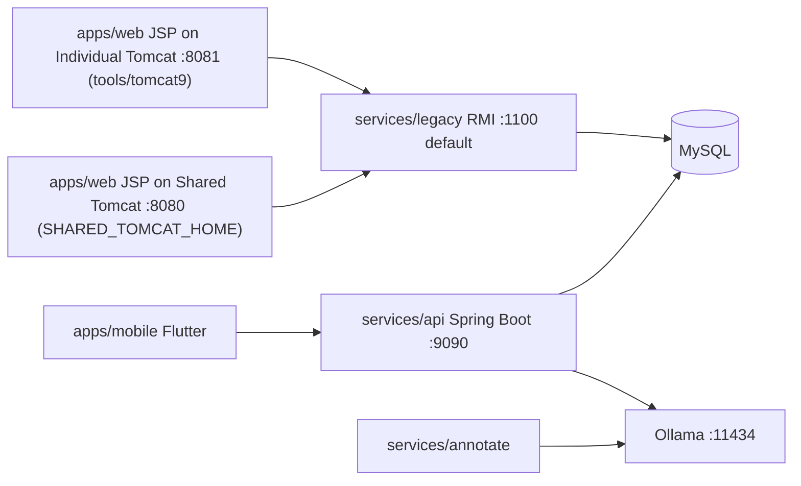

# Architecture

- `apps/web`: JSP pages and static assets. Servlet classes and jars in `WEB-INF` are built from `services/legacy/servlet-src` and `server-src` by `services/legacy/*/makeJar.sh`.
- `tools/tomcat9` (`Tomcat9` symlink): bundled M-Dosthi Individual Tomcat 9 (`:8081`, shutdown `:8006`) mounting `apps/web` at `/mDosthi` via `conf/Catalina/localhost/mDosthi.xml`.
- `services/legacy`: Java RMI business logic (`iMediXBusinessLogic.jar`) started from `runtime/` (default port `1100`, configurable via `LEGACY_RMI_PORT`).
- The JSP app can run on M-Dosthi's Individual Tomcat (`:8081`, `--individual`), on an existing Shared Tomcat 9 (`:8080`, `--shared` / `SHARED_TOMCAT_HOME`) alongside eDosthi, or on both simultaneously against the same M-Dosthi RMI process.
- `services/api`: single Spring Boot API (superset of the older copy previously bundled with the mobile app).
- `services/annotate`: Python pipeline calling local Ollama models.
- `database`: ordered SQL migrations and a Java migration runner.
