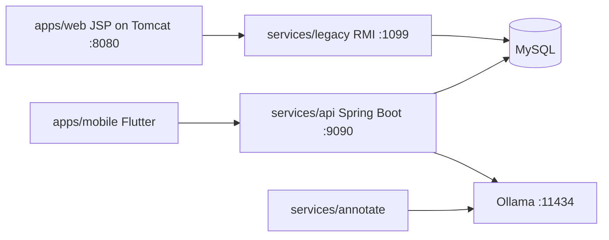

# Architecture

- `apps/web`: JSP pages and static assets. Servlet classes and jars in `WEB-INF` are built from `services/legacy/servlet-src` and `server-src` by `services/legacy/*/makeJar.sh`.
- `services/legacy`: Java RMI business logic (`iMediXBusinessLogic.jar`) started from `runtime/`.
- `services/api`: single Spring Boot API (superset of the older copy previously bundled with the mobile app).
- `services/annotate`: Python pipeline calling local Ollama models.
- `database`: ordered SQL migrations and a Java migration runner.
